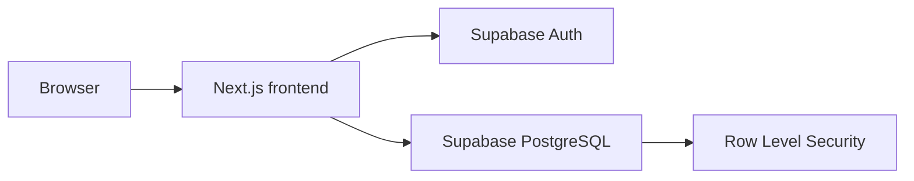

# Bug Tracker

Bug Tracker is a multi-tenant application for reporting, triaging, assigning, and resolving software defects. Signed-in members work within organizations and projects to create issues, discuss them with comments, filter issue queues, and manage status, priority, and assignees. Role-aware access and tenant isolation are enforced by Supabase PostgreSQL.

## Features

Completed MVP capabilities:

- Email/password sign-up, sign-in, sign-out, and profile bootstrap
- Organization creation, organization membership, and owner-controlled role changes
- Project creation, editing, and archiving
- Issue creation, detail views, editing, status and priority management, and member assignment
- Plain-text issue comments with author and timestamp
- URL-backed filtering by status, priority, assignee, and title search
- Bounded issue-list pagination
- Responsive, keyboard-accessible forms and navigation
- Tenant-scoped data access enforced with PostgreSQL Row Level Security

Deferred functionality:

- File attachments
- Email notifications
- Public issue intake
- External integrations
- Granular custom permissions
- Billing
- Analytics
- Real-time collaboration
- Self-service organization invitations
- Production deployment configuration

## Architecture

The application is a single Next.js application in `frontend/`. Supabase provides authentication and PostgreSQL database services; migrations and seed data are kept in `database/supabase/`.



Row Level Security is the authorization boundary for application data. Browser code uses only the Supabase publishable key. The service-role key is server-only and must never be included in browser bundles.

## Repository layout

```text
frontend/            # Next.js application, server actions, components, and tests
database/             # Supabase CLI configuration, migrations, seed data, and policy tests
docs/                 # Product, architecture, and task documentation
.github/              # GitHub automation and repository workflows
```

The repository root contains only project-level controls and entry points such as this README, the license, agent instructions, Git metadata, and GitHub automation.

## Prerequisites

- Node.js 20 or newer
- npm
- Docker Desktop
- Supabase CLI

The setup below runs Supabase locally. It does not create or connect to a hosted Supabase project and does not deploy the application.

## Local setup

From a clean clone, start the local database:

```powershell
# From the repository root
cd database
supabase start
supabase db reset
```

In a second terminal, install and start the frontend:

```powershell
# In a second terminal, from the repository root
cd frontend
npm ci
Copy-Item .env.example .env.local
npm run dev
```

Before opening the application, populate only `NEXT_PUBLIC_SUPABASE_URL` and `NEXT_PUBLIC_SUPABASE_PUBLISHABLE_KEY` in `frontend/.env.local` with the corresponding values from the local `supabase status` output. Do not copy the service-role key into browser code. Never commit `.env.local` or any file containing real credentials.

The local seed data uses fake users and organizations. Authentication users and passwords are controlled by the local Supabase environment; do not use real user data in local fixtures.

## Verification

Run frontend checks from `frontend/`:

```powershell
cd frontend
npm run lint
npm run typecheck
npm test
npm run build
```

Run the local Row Level Security policy test from `database/` while the local Supabase stack is running:

```powershell
cd database
Get-Content -Raw supabase/tests/rls.sql | docker exec -i supabase_db_bug-tracker-local psql -U postgres -d postgres -v ON_ERROR_STOP=1
```

The RLS test executes its assertions inside a transaction and rolls the transaction back, so it does not modify the local database.

## Security model

- Every application table has Row Level Security enabled and policies are managed through migrations under `database/supabase/migrations/`.
- Organization membership is the tenant boundary. Queries and mutations use organization-scoped relationships, and the database rejects cross-organization project, issue, assignee, and comment access.
- The publishable key may be used by browser clients because RLS limits what it can access.
- The service-role key bypasses RLS and must remain server-only. Keep it out of browser code, commits, screenshots, and documentation.
- Server actions validate external form input before database writes, while PostgreSQL constraints and RLS provide the final enforcement boundary.

See [the architecture brief](docs/architecture.md) for the full data model, authorization rules, environment contract, and operational standards.

## Project status and roadmap

The current implementation covers the initial organization, project, issue, comment, filtering, and access-control workflows. Product scope and deferred capabilities are documented in [the product brief](docs/product-brief.md). Ordered implementation work is tracked in [the master task plan](docs/tasks/MASTER-TASK.md).

Deployment, invitations, attachments, notifications, integrations, billing, analytics, and real-time collaboration are not part of the initial release. A hosted Supabase project and production deployment must be designed and configured separately.

## License

MIT — see [LICENSE](LICENSE).
