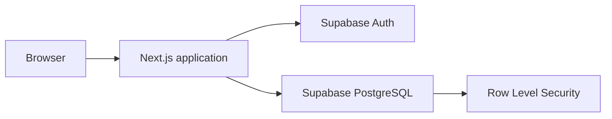

# Bug Tracker

Bug Tracker is a multi-tenant workspace for reporting, triaging, assigning, and resolving software defects. Teams organize work by organization and project, keep issue discussions in context, and use database-enforced authorization boundaries to protect tenant data.

## What it includes

- Email/password authentication with profile bootstrap
- Organization creation and owner-managed membership roles
- Project creation, editing, and archiving
- Issue creation and updates for title, description, status, priority, and assignee
- List and compact grid views for project issue queues
- URL-backed filtering by status, priority, assignee, and title
- Bounded issue pagination
- Plain-text comments with author and timestamp
- Organization dashboard with solved, in-progress, unsolved, total, and active-project metrics
- Per-project status summaries that scale to actual issue counts
- Light, dark, and retro development themes with local persistence
- Responsive keyboard-accessible navigation, forms, loading states, and error states
- PostgreSQL Row Level Security for tenant isolation

## Architecture

The application is a single Next.js application in `frontend/`. Supabase
provides authentication and PostgreSQL services. Migrations, seed data, and
the RLS regression harness are stored in `database/supabase/`.



Row Level Security is the authorization boundary. Browser code uses only the
Supabase publishable key. The service-role key is server-only and must never
be included in browser bundles, images, commits, or documentation.

## Repository layout

```text
frontend/            # Next.js application, server actions, components, and tests
database/             # Supabase configuration, migrations, seed data, and RLS tests
docs/                 # Product, architecture, release, and UI documentation
.github/              # GitHub automation and repository workflows
Dockerfile            # Production frontend image
```

## Prerequisites

- Node.js 20 or newer
- npm
- Docker Desktop
- Supabase CLI for local database and authentication services

## Local development

Start the local Supabase services from the repository root:

```powershell
cd database
supabase start
supabase db reset
```

In a second terminal, install and start the frontend:

```powershell
cd frontend
npm ci
Copy-Item .env.example .env.local
npm run dev
```

Populate only these public variables in `frontend/.env.local` using values from
`supabase status`:

```dotenv
NEXT_PUBLIC_SUPABASE_URL=
NEXT_PUBLIC_SUPABASE_PUBLISHABLE_KEY=
```

Never commit `.env.local` or place the service-role key in browser-facing
configuration. The local seed data uses fake users, organizations, and
credentials.

## Docker

Build and run the production frontend from the repository root:

```powershell
docker build -t bug-tracker .
docker run --rm -p 3000:3000 `
  -e NEXT_PUBLIC_SUPABASE_URL=https://your-project.supabase.co `
  -e NEXT_PUBLIC_SUPABASE_PUBLISHABLE_KEY=your-publishable-key `
  bug-tracker
```

The image contains the Next.js application only. Supabase Auth and PostgreSQL
must be supplied by a local or hosted Supabase environment.

## Verification

Run frontend checks from `frontend/`:

```powershell
cd frontend
npm run lint
npm run typecheck
npm test
npm run build
npm run test:e2e
```

The Playwright workflow requires a running Supabase environment and valid local
test credentials. Run the RLS regression harness while the local Supabase
stack is running:

```powershell
cd database
Get-Content -Raw supabase/tests/rls.sql | docker exec -i supabase_db_bug-tracker-local psql -U postgres -d postgres -v ON_ERROR_STOP=1
```

The RLS harness runs its assertions inside a transaction and rolls the
transaction back.

## Security

- Every application table has Row Level Security enabled.
- Organization membership is the tenant boundary.
- Composite relationships prevent cross-organization projects, issues,
  assignees, and comments.
- Server actions validate external input before database writes.
- PostgreSQL constraints and RLS provide final authorization enforcement.
- Database changes are managed through timestamped migrations under
  `database/supabase/migrations/`.

For the detailed data model and authorization rules, see
[docs/architecture.md](docs/architecture.md). Product scope is documented in
[docs/product-brief.md](docs/product-brief.md), and UI decisions are documented
in [docs/ui-design.md](docs/ui-design.md).

## Deferred capabilities

File attachments, email notifications, public issue intake, external
integrations, granular custom permissions, billing, analytics, real-time
collaboration, self-service invitations, and hosted deployment configuration
are intentionally outside the current release.

## License

MIT — see [LICENSE](LICENSE).
