# Detailed Architecture Flow

This diagram expands the high-level architecture in the
[project README](../README.md) without changing the README's concise overview.

```mermaid
flowchart TB
  User([User])

  subgraph Client["Client browser"]
    UI["Next.js App Router UI<br/>Pages, forms, filters, list/grid views"]
    Theme["Theme provider<br/>light, dark, retro + localStorage"]
    UI --> Theme
  end

  subgraph Next["Next.js application"]
    Public["Public routes<br/>landing, sign-in, sign-up"]
    Protected["Protected workspace routes<br/>organization dashboard, projects, issues"]
    Middleware["Auth-aware route protection"]
    Actions["Server actions<br/>validate input and perform mutations"]
    Queries["Server-side queries<br/>load tenant-scoped data"]
    Errors["Loading and error boundaries"]

    Public --> Middleware
    Protected --> Middleware
    Protected --> Queries
    Protected --> Actions
    Public --> Errors
    Protected --> Errors
    Actions --> Errors
    Queries --> Errors
  end

  subgraph Supabase["Supabase backend"]
    Auth["Supabase Auth<br/>email/password sessions"]
    API["Supabase client APIs<br/>publishable key in browser"]

    subgraph Postgres["PostgreSQL"]
      RLS["Row Level Security<br/>authorization boundary"]
      Memberships["organization_memberships<br/>owner/member roles"]
      Organizations["organizations"]
      Projects["projects<br/>organization-scoped"]
      Issues["issues<br/>status, priority, assignee"]
      Comments["comments<br/>issue discussion"]

      Organizations --> Memberships
      Organizations --> Projects
      Projects --> Issues
      Issues --> Comments
      Memberships -. "membership checks" .-> RLS
      Organizations -. "tenant context" .-> RLS
      Projects -. "tenant policies" .-> RLS
      Issues -. "tenant policies" .-> RLS
      Comments -. "tenant policies" .-> RLS
    end
  end

  User --> UI
  UI -->|"session and form requests"| Middleware
  Middleware -->|"read session"| Auth
  UI -->|"browser-safe reads"| API
  API --> RLS
  Actions -->|"server-side mutations"| API
  Queries -->|"server-side reads"| API
  API --> Auth
  API --> RLS
  Auth -->|"authenticated user ID"| RLS

  subgraph Operations["Repository and operations"]
    Migrations["database/supabase/migrations<br/>schema, constraints, policies"]
    Seed["database/supabase/seed.sql<br/>local fixtures"]
    Harness["database/supabase/tests/rls.sql<br/>authorization regression tests"]
    Docker["Dockerfile<br/>Next.js standalone production image"]
  end

  Migrations --> Postgres
  Seed --> Postgres
  Harness --> RLS
  Docker --> Next
```

## Request and authorization flow

1. A user interacts with the browser UI.
2. Public and protected routes are handled by the Next.js App Router.
3. Route protection reads the Supabase Auth session before allowing access to
   the workspace.
4. Server actions validate form input before mutations are sent to Supabase.
5. Server-side queries load only the tenant-scoped data requested by the
   workspace.
6. Supabase Auth provides the authenticated user identity.
7. PostgreSQL evaluates organization membership, ownership, composite tenant
   relationships, and Row Level Security policies.
8. Only authorized data is returned or mutations are applied.

Row Level Security is the final authorization boundary, not the UI or route
guard. Browser code uses only the Supabase publishable key. The service-role
key is server-only and must never be included in browser bundles, images,
commits, or documentation.
